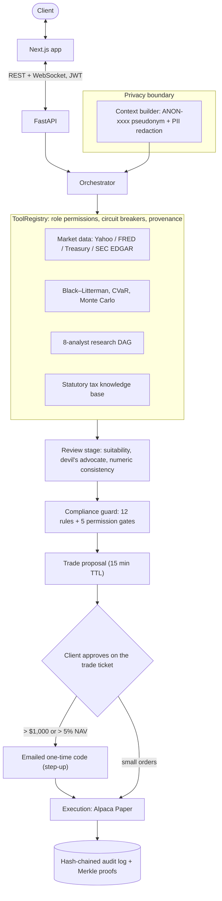

# FinFuture: Non-Discretionary AI Wealth Advisory Agent

FinFuture is a **non-discretionary, human-in-the-loop** multi-agent wealth advisor built for the **2026 8th FinTechathon, International Track, Topic B: Wealth Advisory Agent**. It profiles a client in conversation, compares ETFs and bonds against that profile, builds an explainable allocation, catches behavioural biases, and executes the client's approved order in a **paper-trading sandbox**. Every recommendation and trade passes a deterministic compliance firewall, and every step is written to a tamper-evident audit trail.

> **The model writes the words; deterministic Python supplies the numbers; no trade executes without the client's explicit approval.** Orders above \$1,000 or 5 % of the portfolio also need a one-time code emailed to the client.

| | |
| :--- | :--- |
| **Live app** | <https://fin-future.vercel.app> |
| **API** (OpenAPI docs at `/docs`) | <https://finfuture.onrender.com> (free tier: the first request after idle can take 30–60 s) |
| **Repository** | <https://github.com/g93sambo/FinFuture> |

---

## Submission checklist

| # | Deliverable (competition rules) | Where |
| :--- | :--- | :--- |
| 01 | Technical documentation: system architecture, core algorithms, security design | [`docs/TECHNICAL_DOCUMENTATION.md`](docs/TECHNICAL_DOCUMENTATION.md) |
| 02 | Presentation deck (≤ 10 min) | Submitted through the competition portal |
| 03 | Demo video (≤ 5 min) | Submitted through the competition portal |
| 04 | Source code with README, deployment instructions and test cases | This repository: [Quickstart](#quickstart), [Deployment](#deployment), [Tests](#tests) |
| 05 | Security self-assessment: permission tiers and known-risk list | [`SECURITY_SELF_ASSESSMENT.md`](SECURITY_SELF_ASSESSMENT.md) |
| 06 | Execution evidence: sandbox operation logs | [`evidence/live_e2e_results.json`](evidence/live_e2e_results.json) (live run with the hash-chained audit entries) and the app's **Audit trail** page |

---

## What it does

The end-to-end loop is **profile → compare → recommend → explain → approve → execute → monitor**.

1. **Conversational risk profiling** (`agents/risk_profiler.py`). Tap-to-answer chips plus free-text extraction build a typed profile. The risk tier is calibrated as min(stated, revealed) from drawdown-reaction questions.
2. **Product comparison and suitability filtering** (`agents/product_comparison.py`). ETFs and bonds are scored on six factors against the client's horizon, liquidity needs and risk tier, with a written rationale. Unsuitable products are filtered out before display.
3. **Explainable allocation** (`agents/allocation_engine.py`, `services/financial_engineering.py`). Black–Litterman posterior returns, 95 % CVaR optimisation and a 10,000-path Student-t Monte Carlo, with a plain-English summary and a technical rationale.
4. **Behavioural bias detection** (`agents/behavioral_bias.py`). The agent detects loss aversion, recency bias, overconfidence, herd mentality and the disposition effect in dialogue and intervenes with debiasing nudges.
5. **Runtime compliance** (`agents/compliance_guard.py`). Twelve rules (suitability, concentration, regulatory language, KYC, AML) plus five permission gates run in plain Python outside the LLM.
6. **Human-approved paper execution** (`agents/execution_module.py`). Orders go to **Alpaca Paper Trading**, with a clearly labelled simulated fill when no broker key is configured.
7. **Portfolio health monitoring** (`services/health_report.py`). Drift against target, performance, macro context and a natural-language health report.
8. **Tamper-evident audit trail** (`services/audit_logger.py`, `services/anchoring.py`). An append-only SHA-256 hash chain with HMAC signatures and verifiable Merkle inclusion proofs. The Merkle root can be anchored on the Ethereum **Sepolia** testnet and checked on Etherscan (see [Checking on-chain anchors](#checking-on-chain-anchors)).

## Architecture



### Permission tiers

Each tier is backed by code that the tier below cannot reach. The catalogue is served live at `GET /api/v1/compliance/permission-tiers`.

| Tier | What it may do | What enforces the limit |
| :--- | :--- | :--- |
| `TIER_1_READ_ONLY` | Quotes, macro, filings, own portfolio and audit reads | Read-only tools; providers receive tickers and series IDs only |
| `TIER_2_ADVISE` | Profiling, comparison, allocation, simulation, research | Modules return data only and have no broker client |
| `TIER_3_PROPOSE_TRADE` | Stage a proposal with a 15-minute TTL | No broker call; refuses non-whitelisted symbols and locked accounts |
| `TIER_4_EXECUTE_WITH_APPROVAL` | Submit an approved order to the paper broker | Explicit approval, 12-rule check, \$100k per-trade cap, \$250k rolling 24 h cap, 101-symbol whitelist (US ETFs and large caps tradable on Alpaca), circuit breaker, 30 s duplicate lock, and **a step-up one-time code above \$1,000 or 5 % NAV** |
| `TIER_5_AUTONOMOUS_DISABLED` | Nothing | Refused at start-up, at the API and in the compliance guard |

### Step-up verification for trade approval

Orders above \$1,000 or above 5 % of the portfolio ("Red tier") need a second factor:

1. The trade ticket calls `POST /api/v1/trade/{proposal_id}/step-up`.
2. The server generates **6 random digits**, stores only an HMAC-SHA256 digest bound to that user and proposal, and **emails the code** to the account address (Brevo, Resend or SMTP).
3. The client enters the code and confirms the attestation. The code expires after 5 minutes, allows 5 attempts, works once, and resends are throttled.
4. The compliance guard accepts the order only after the server has verified the code. Approvals by chat or WebSocket without a code are turned back to the ticket.

Issue, success and failure events go into the audit chain. Details and residual risks are in [`SECURITY_SELF_ASSESSMENT.md`](SECURITY_SELF_ASSESSMENT.md) §2.1 and `RISK-07`.

### Data that leaves the backend

- **Market, macro and filing APIs** receive public identifiers only (tickers, CIKs, series IDs).
- **The LLM API** receives dialogue and suitability parameters after `redact_sensitive_data()` strips direct PII and the client is replaced by an `ANON-xxxxxxxx` pseudonym. All numbers, scoring and compliance are computed locally.
- **The paper broker** receives `(symbol, side, qty)` only.
- **Email** receives the code and order summary, sent to the account owner.

---

## Quickstart

Requirements: Python 3.11–3.12 and Node.js 18+. No API keys are needed for a local run: without them FinFuture uses SQLite, an in-memory cache, cached market fixtures, simulated paper fills and console delivery for step-up codes.

```bash
git clone https://github.com/g93sambo/FinFuture.git && cd FinFuture
cp .env.example .env                     # optional: add keys (see Configuration)

# Backend (http://localhost:8000, API docs at /docs)
cd backend
python -m venv .venv
source .venv/bin/activate                # Windows: .venv\Scripts\activate
pip install -r requirements.txt
uvicorn main:app --reload --port 8000

# Frontend (http://localhost:3000), in a second terminal
cd frontend
npm install
npm run dev                              # set NEXT_PUBLIC_API_URL if the API is not on localhost:8000
```

**Trying a Red-tier trade locally without email:** the step-up code is printed in the backend log (`[OTP console delivery]`). To have the trade ticket display it during a local demo instead, set `OTP_DEV_ECHO=true` in `.env`; production refuses that flag.

### Docker

```bash
cp .env.example .env
docker compose up --build                # PostgreSQL + Redis + backend + frontend
```

The frontend runs at <http://localhost:3000> and the API at <http://localhost:8000/docs>.

---

## Configuration

All settings are environment variables, documented in [`.env.example`](.env.example). The backend reads `.env` from the repository root or from `backend/`.

| Variable | Purpose | Default |
| :--- | :--- | :--- |
| `ENVIRONMENT` | `production` turns on the start-up guards below | `development` |
| `SECRET_KEY`, `AUDIT_SECRET_KEY` | JWT and audit-HMAC keys. Production requires two different random values of 32+ characters | development keys |
| `DATABASE_URL` | `postgresql+asyncpg://…` or `sqlite+aiosqlite:///…` | local SQLite |
| `REDIS_URL` | Shared cache, locks and OTP challenges (required to run more than one instance) | in-memory fallback |
| `BREVO_API_KEY` / `RESEND_API_KEY` / `SMTP_*`, `EMAIL_FROM` | Email delivery for step-up codes; configure one provider | console (development only) |
| `ALPACA_API_KEY`, `ALPACA_SECRET_KEY` | Alpaca **paper** account | simulated fills |
| `OPENAI_API_KEY`, `OPENAI_MODEL` | LLM for dialogue and synthesis | deterministic fallbacks |
| `FRED_API_KEY` | Macro series | cached fixtures |
| `SEPOLIA_RPC_URL`, `SEPOLIA_PRIVATE_KEY`, `AUDIT_CONTRACT_ADDRESS` | Optional Merkle-root anchoring on Sepolia | anchoring off (nothing is sent) |
| `AUTH_RATE_LIMIT_ENABLED`, `REGISTER_MAX_PER_IP_PER_HOUR`, `LOGIN_FAILURES_MAX_PER_IP` | Per-IP limits on sign-ups and failed logins (each account also locks after 5 failures) | on; 10 per hour; 30 per 15 min |

**Start-up refuses to run** with `ALLOW_AUTONOMOUS_EXECUTION=true`, `ALPACA_PAPER=false`, a live Alpaca URL, or any chain other than Sepolia. With `ENVIRONMENT=production` it also refuses default or shared secrets, `DEBUG=true` and `OTP_DEV_ECHO=true`.

---

## Deployment

The reference deployment uses **Vercel** for the frontend and **Render** for the backend.

**Backend (Render web service, root `backend/`)**
- Build: `pip install -r requirements.txt`
- Start: `uvicorn main:app --host 0.0.0.0 --port $PORT --proxy-headers`
- Environment: `ENVIRONMENT=production`, `SECRET_KEY`, `AUDIT_SECRET_KEY`, `DATABASE_URL` (Render PostgreSQL), `CORS_ORIGINS=https://<your-frontend>`, and an email provider. Render's free tier blocks outbound SMTP, so use `BREVO_API_KEY` plus a verified `EMAIL_FROM`.
- Run **one instance** unless `REDIS_URL` points at a shared Redis: proposals, OTP challenges and throttles otherwise live in process memory.

**Frontend (Vercel, root `frontend/`)**
- Environment: `NEXT_PUBLIC_API_URL=https://<your-backend>`.

The `backend/Dockerfile` and `frontend/Dockerfile` also work on any container host.

---

## Tests

```bash
# From the repository root. Windows PowerShell: $env:PYTHONPATH="backend;."
export PYTHONPATH=backend:.
python -m pytest backend/tests tests/e2e_research tests/unit -q
```

Focused suites:

| Area | Command |
| :--- | :--- |
| Step-up OTP | `python -m pytest backend/tests/unit/test_step_up_otp.py -q` |
| Compliance, permission tiers, security | `python -m pytest backend/tests/unit/test_compliance_guard.py backend/tests/unit/test_challenger_m4_compliance.py backend/tests/unit/test_challenger_m5_security.py backend/tests/unit/test_permission_tiers_and_privacy.py backend/tests/unit/test_config.py -q` |
| Advisor quality evals | `python -m pytest backend/tests/evals -q` |
| Production hardening (attachments, auth throttles, tenant checks, public routes) | `python -m pytest backend/tests/unit/test_production_hardening.py -q` |
| Frontend checks | `cd frontend && npm run check:prod && npm run lint && npm run typecheck && npm run build` |

`.github/workflows/ci.yml` runs the Python suite, a check that production settings refuse insecure values, and the frontend checks (including `check:prod`, which fails on leftover `console.log`, `debugger`, placeholder text or hard-coded localhost URLs) on every push.

---

## Checking on-chain anchors

Anchoring is optional (Topic B does not require on-chain evidence) and uses the **Ethereum Sepolia testnet**, so it costs nothing real.

**Turn it on**
1. Create a new wallet used only for this, for example in MetaMask, and export its private key. Never reuse a wallet that holds real funds.
2. Get free Sepolia ETH for it from a faucet such as <https://cloud.google.com/application/web3/faucet/ethereum/sepolia> or <https://www.alchemy.com/faucets/ethereum-sepolia>. About 0.05 ETH covers hundreds of anchors.
3. Set `SEPOLIA_RPC_URL` (free from Infura or Alchemy) and `SEPOLIA_PRIVATE_KEY` on the backend and restart it. The Audit page then shows the wallet, its balance and an enabled **Anchor** button.

**Check an anchor**
1. On the Audit page, click **Anchor**. The app sends a zero-value transaction from the wallet to itself whose input data is the 32-byte Merkle root of your audit trail, and shows the transaction hash.
2. The hash links to `https://sepolia.etherscan.io/tx/<hash>`. Anyone can open it without an account.
3. On Etherscan, click **Click to show more** and compare **Input Data** with the Merkle root shown in the app. They must match exactly.
4. The anchor is also written into the audit trail as an `AUDIT_ANCHORED` entry, so the Audit page lists every past anchor with its Etherscan link. Every anchor from the wallet is also visible on the wallet's Etherscan page.

To recompute the root yourself, run `python tools/verify_audit.py`. A root covers the entries that existed when it was anchored; later entries produce a new root.

## Repository layout

```
backend/        FastAPI app: agents/, api/routes/, services/, research/, tools/, db/, tests/
frontend/       Next.js 14 app (App Router, Tailwind)
docs/           Technical documentation
evidence/       Live-run results with the audit hash-chain proof
tests/          Requirement-driven end-to-end research suites
tools/          Audit-chain verification utility
```

## License

[MIT](LICENSE). Third-party data and libraries are used under their own licences; see `docs/TECHNICAL_DOCUMENTATION.md` §8.
