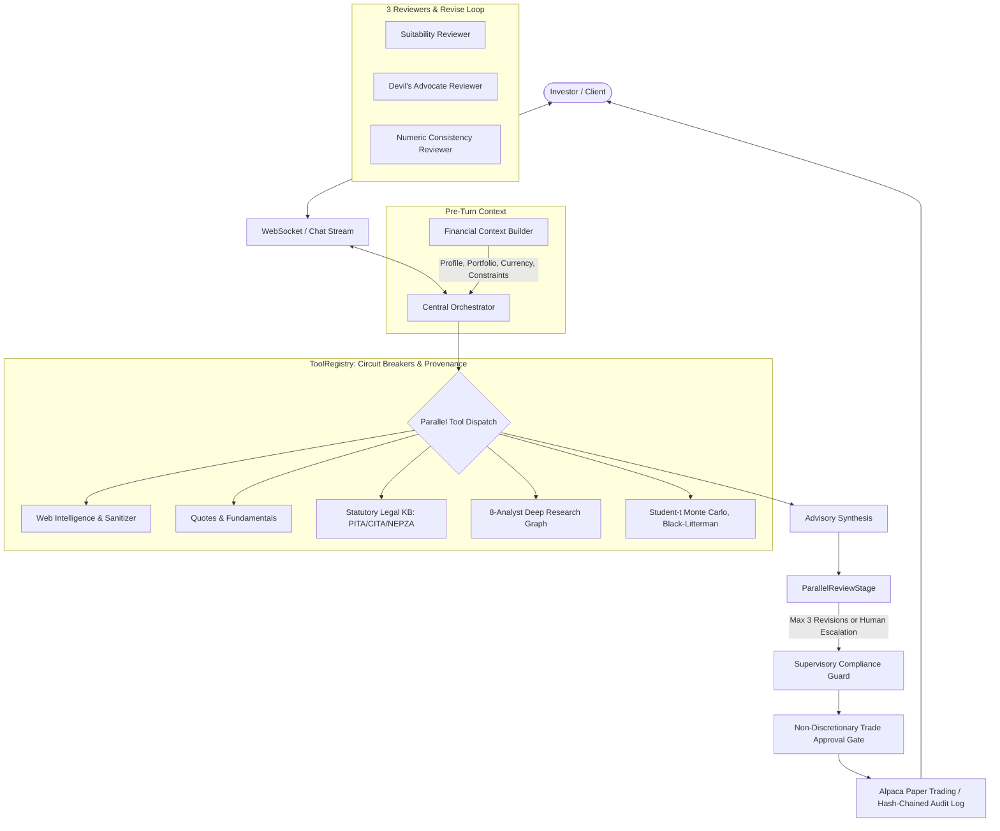

# FinFuture: Autonomous AI Wealth Advisory Platform

FinFuture is an enterprise-grade multi-agent wealth management and quantitative advisory platform combining continuous conversational memory, deterministic tool calling, non-discretionary trade execution, autonomous deep equity research, statutory tax structuring, and supervisory compliance auditing.

---

## 🏛️ System Architecture

FinFuture operates a 3-loop, multi-stage pipeline ensuring mathematical rigor, fiduciary safety, and auditability:



---

## 🛡️ Model Limitations & Fiduciary Safety Matrix

FinFuture strictly adheres to the principle: **"Code supplies the numbers; the model supplies the synthesis."** LLMs never compute portfolio arithmetic, invent tax statutes, or execute trades autonomously.

| Advisory Domain | Model Role | Deterministic Code & Guardrail | Limitation & Mitigation |
| :--- | :--- | :--- | :--- |
| **Asset Allocation & Hurdle Rates** | Qualitative explanation of asset class suitability and risk/return trade-offs. | `financial_engineering.py` & `black_litterman.py` solve hurdle rates, covariance matrices, and Monte Carlo paths. | Model cannot hallucinate yields or returns; all figures must originate from tool payloads. |
| **Trade Execution** | Translates user intent into formal order proposals (`symbol`, `side`, `qty`). | `ExecutionModule`: Non-discretionary 15-minute proposal lock, 30-second idempotency guard, and explicit user signature required. | Zero autonomous/discretionary order placement. Unapproved trades are rejected. |
| **Statutory Tax & Legal Structuring** | Synthesizes estate planning roadmaps based on retrieved statutes. | `legal_knowledge.py`: Curated verbatim clauses from PITA, CITA, CGTA, NEPZA, and PRA 2014. | Model does not cite statutes from training weights; statutes must be retrieved via `search_legal_statutes`. |
| **Client Onboarding & Profiling** | Natural conversational dialogue and clarification questions. | Deterministic FSM state machine + tap-to-answer option chips. Age gating (<18 rejection) is enforced in code. | Prevents repetitive stuck loops ("im 19"); separates income parsing from goal assignment. |
| **External Intelligence & Web Search** | Summarizes news, prospectuses, and earnings releases. | `sanitizer.py` isolates untrusted web text inside `<untrusted_external_content>` XML fences. | Eliminates prompt-injection vectors from adversarial online HTML/filings. |
| **Advisory Review Stage** | Rewrites proposals when audit flaws are flagged (up to 3 revisions). | Parallel `Suitability`, `DevilsAdvocate`, and `NumericConsistency` reviewers enforce boundary conditions. | If advice remains flawed after 3 revisions, it automatically escalates to a human fiduciary supervisor. |

---

## ⚡ Key Capabilities

1. **Central Tool Registry**:
   - Every chat tool call is routed through `ToolRegistry` with role checks (`Orchestrator`), circuit breakers, execution timeouts, rate limits, and provenance logging.
   - Independent tools execute concurrently in parallel via `asyncio.gather`.

2. **Autonomous Deep Research Engine**:
   - Multi-agent research graph with 8 specialized roles: Macro Analyst, Financial Analyst, Investment Research Analyst, Quantitative Analyst, Intelligence Analyst, Risk & Devil's Advocate, Personalized Advisory, and Compliance Guard.
   - Live milestone telemetry streamed over WebSockets and verifiable citations stored in `EvidenceLedger`.

3. **Robust Onboarding**:
   - Interactive tap-to-answer suggestion chips on client messages.
   - Deterministic extraction for age, dependents, liquid assets, and employment with model extraction fallback for ambiguous phrasing.
   - Fixes the "income is 90k" goal corruption bug.

4. **Institutional Black-Litterman Allocation**:
   - Combines market equilibrium returns ($\Pi$) with Research Engine views ($P, Q, \Omega$) to derive posterior expected returns ($\mu_{BL}$) and target allocations ($w^*$).

5. **Data Breadth & Offline Demo Mode**:
   - Cross-border directory of US Equities and Nigerian (NGX) equities (DANGCEM, MTNN, GTCO, ZENITHBANK, etc.).
   - Live/fallback FX currency conversion (USD/NGN).
   - High-fidelity offline demo replay (`DEMO_MODE=true` or `[DEMO]`) for network-free live presentations.
   - Downloadable, print-ready PDF/HTML research report export (`GET /api/v1/research/{request_id}/download`).

---

## 🚀 Quickstart & Verification

### Backend Setup
```bash
cd backend
python -m venv .venv
# Activate environment
pip install -r requirements.txt
```

### Running the Test & Evaluation Suites
```bash
# Run unit tests and contract validations
$env:PYTHONPATH="backend;."; pytest backend/tests/unit/ tests/e2e_research/ -v

# Run legal retrieval evaluation set
$env:PYTHONPATH="backend;."; pytest backend/tests/unit/test_legal_retrieval.py -v

# Run end-to-end AI quality & onboarding eval suite
$env:PYTHONPATH="backend;."; pytest backend/tests/evals/test_advisor_eval_suite.py -v

# Run Black-Litterman asset allocation tests
$env:PYTHONPATH="backend;."; pytest backend/tests/unit/test_black_litterman.py -v
```

### Frontend Build
```bash
cd frontend
npm install
npm run build
```