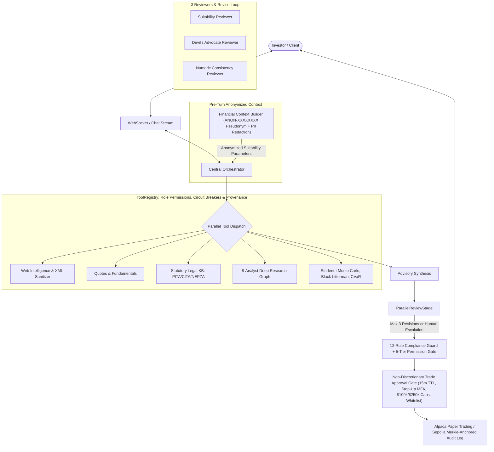

# FinFuture: Non-Discretionary AI Wealth Advisory Platform

FinFuture is an institutional-grade, **non-discretionary, human-in-the-loop** multi-agent wealth management and quantitative advisory platform built for the **2026 8th FinTechathon (International Track · Topic B: Wealth Advisory Agent)**. It combines conversational risk profiling, deterministic quantitative portfolio engineering, multi-analyst equity research, statutory tax structuring, a code-enforced **5-tier permission model**, a **12-rule compliance firewall**, and an **RFC 6962 Merkle-anchored audit trail** on Ethereum Sepolia.

---

## 🏛️ System Architecture

FinFuture operates a 3-loop, multi-stage pipeline ensuring mathematical rigor, fiduciary safety, and cryptographic auditability. **The model writes the words, deterministic Python code supplies the numbers, and no trade can ever execute without explicit human approval under code-enforced limits.**



---

## 🔐 Code-Enforced 5-Tier Permission Model

Every agent action and user request is governed by an explicit **5-tier permission model** enforced in `backend/agents/compliance_guard.py`, `backend/agents/orchestrator.py`, and `backend/api/routes/trade.py` (`GET /api/v1/compliance/permission-tiers`):

| Tier ID | Badge | Scope | Code-Enforced Limits & Safeguards |
| :--- | :--- | :--- | :--- |
| **`TIER_1_READ_ONLY`** | `GREEN` | **Read-Only Data** | Zero state mutation; market quotes, FRED macro series, SEC EDGAR filings, portfolio & audit reads. |
| **`TIER_2_ADVISE`** | `GREEN` | **Advise & Simulate** | Risk profiling (`RiskProfiler`), ETF/Bond comparison (`ProductComparator`), Black-Litterman/CVaR & Student-$t$ Monte Carlo (`AllocationEngine`), 3-reviewer verification loop. Cannot stage or submit orders. |
| **`TIER_3_PROPOSE_TRADE`** | `YELLOW` | **Propose Trade** | Stages an unsigned `TradeProposal` with a 15-minute TTL. Enforces Anomaly Circuit Breaker (`PERM-CIRCUIT-BREAKER`) and the 129-symbol whitelist (`PERM-WHITELIST`) at proposal creation. Cannot call broker APIs. |
| **`TIER_4_EXECUTE_WITH_APPROVAL`** | `RED` | **Execute with Human Approval Under Limits** | Requires `user_approved=True` (`REG-003`) + 12-rule compliance pass + **Per-Trade Cap (`$100,000.00` / `AML-001`)** + **Rolling 24h Daily Cap (`$250,000.00` / `PERM-CAP-DAILY`)** + **129-symbol Whitelist (`PERM-WHITELIST`)** + **Step-Up 6-Digit MFA OTP & Attestation (`PERM-STEP-UP-MFA`)** for orders $> \$1,000$ or $> 5\%$ NAV + **30s Idempotency Lock**. |
| **`TIER_5_AUTONOMOUS_DISABLED`** | `DISABLED` | **Autonomous Execution (Hard-Disabled)** | Explicitly disabled at startup (`core/config.py:guard_autonomous_execution_disabled`), API layer (`api/routes/trade.py`), and compliance firewall (`PERM-TIER-5`). The agent can never trade without live per-order human approval. |

---

## 🛡️ External API & LLM Data Privacy Architecture

FinFuture enforces strict data minimization and anonymization across external boundaries:

- **Market, Macro & Filing APIs (`Yahoo Finance`, `FRED`, `SEC EDGAR`, `Finnhub`):** Receive **only public ticker symbols (`SPY`, `BND`), CIK numbers, or macro series IDs**. Zero client data is ever transmitted.
- **External LLM Inference API (`OpenAI` / `Gemini`):** Receives the profiling and advisory conversation (including numerical suitability parameters such as age, income/net worth, risk score, and investment horizon) so the model can extract onboarding fields and synthesize tailored commentary. Before any LLM request is sent:
  1. `ComplianceGuard.redact_sensitive_data()` (`backend/agents/orchestrator.py`) strips direct PII (self-reported names, email addresses, phone numbers, SSN/BVN/NIN national IDs, credit/debit card numbers, IBANs, and API/bearer tokens) from user messages and chat history.
  2. `ClientFinancialContext.to_system_prompt_snippet()` (`backend/services/context_builder.py`) replaces `client_id` and `full_name` with a one-way truncated SHA-256 pseudonym (`ANON-XXXXXXXX`).
  3. All risk scoring, portfolio optimization, and compliance checks execute locally in deterministic Python code.

---

## ⚡ Key Capabilities

1. **Central Tool Registry (`backend/tools/`)**:
   - Every chat tool call is routed through `ToolRegistry` with role permissions (`Orchestrator`), circuit breakers, execution timeouts, rate limits, and provenance logging.
   - Independent tools execute concurrently in parallel via `asyncio.gather`.

2. **8-Analyst Multi-Agent Research Engine (`backend/research/`)**:
   - Declarative DAG with 8 specialist analyst roles: Macro Analyst, Financial Analyst, Investment Research Analyst, Quantitative Analyst, Intelligence Analyst, Risk & Devil's Advocate, Personalized Advisory, and Compliance Guard.
   - Live milestone telemetry streamed over WebSockets and verifiable citations stored in `EvidenceLedger`.

3. **Hybrid Conversational & Structured Onboarding (`backend/agents/risk_profiler.py`)**:
   - Interactive tap-to-answer suggestion chips paired with deterministic + LLM-assisted field extraction and behavioral stress calibration ($\min(\text{Stated}, \text{Revealed})$ risk tier).

4. **Institutional Quantitative Engine (`backend/services/financial_engineering.py`, `backend/agents/allocation_engine.py`)**:
   - Black-Litterman posterior return blending, 95% CVaR optimization, 10,000-path Student-$t$ ($\nu=5$) Monte Carlo simulation, numerical hurdle-rate bisection solver, and multi-factor macro stress testing.

5. **Tamper-Evident Audit Trail & Dual-Ledger Anchoring (`backend/services/audit_logger.py`, `backend/services/anchoring.py`)**:
   - Append-only SHA-256 hash chain + HMAC-SHA256 entry signatures + RFC 6962 binary Merkle tree root anchored simultaneously to **Ethereum Sepolia (`chain_id=11155111`)** and the **WeBank FISCO BCOS v3.6 Consortium Blockchain (`group0` PBFT + WeEvent topic `com.webank.finfuture.audit.anchor`)** with per-entry inclusion proofs (`GET /api/v1/audit/{client_id}/merkle-proof/{entry_id}`).

---

## 🏦 WeBank Open-Source Fintech Ecosystem Integration

FinFuture natively integrates four core pillars of the **WeBank (微众银行)** fintech stack for the **2026 8th FinTechathon (WeBank Fintech College Students Challenge)**:

1. **WeBank FISCO BCOS v3.6 Consortium Blockchain (`backend/services/anchoring.py`, `POST /api/v1/audit/{client_id}/anchor/fisco-bcos`)**:
   - Dual-anchors RFC 6962 audit Merkle roots to both Ethereum Sepolia (`chain_id=11155111`) and a **WeBank FISCO BCOS v3.6 Consortium Ledger (`group0`, 4-node PBFT sub-second finality, `AuditAnchorConsortium.sol`)**.
2. **WeBank WeEvent v1.12 Event-Driven Governance Mesh**:
   - Publishes every audit Merkle anchor and compliance circuit-breaker event to the WeEvent broker topic `com.webank.finfuture.audit.anchor` with deterministic `weevent-group0-<block>-<hash>` event receipts.
3. **WeBank FATE v2.0 Privacy-Preserving Feature Envelope (`ClientFinancialContext.to_fate_privacy_envelope()`)**:
   - Discretizes client suitability attributes into banded federated feature vectors (`party_id="WEBANK_FINFUTURE_GUEST_9999"`, `pseudonym_id="ANON-XXXXXXXX"`, `age_band`, `net_worth_tier`, `gba_wealth_connect_eligible`) signed with a SHA-256 Paillier/PSI-ready commitment hash (`raw_pii_exposed=False`).
4. **WeBank Smart Wealth (`微众银行财富+`) & GBA Cross-Border Wealth Connect (`跨境理财通`) Product Shelf (`backend/services/providers/screener.py`, `backend/agents/product_comparison.py`)**:
   - First-class quantitative screening, 6-factor scoring, and compliance whitelist support for:
     - `WBKCASH`: *WeBank Live+ Cash Management Fund (微众活期+ R1 Money Market)*
     - `WBK6M`: *WeBank Steady+ 180D Short-Duration Bond Note (微众稳健+ R2)*
     - `GBAHK`: *WeBank GBA Wealth Connect Multi-Asset Income ETF (跨境理财通南向通 R2)*
     - `WBKGLD`: *WeBank Digital Gold Accumulation Trust (微众黄金 Inflation Hedge R3)*

---

## 🚀 Quickstart, Environment Setup & Verification

### 1. Environment Variables (`backend/.env`)
Copy `backend/.env.example` to `backend/.env`. All secrets are read from environment variables (safe development defaults are provided for offline testing):

| Variable | Description | Default (Dev / Sandbox) |
| :--- | :--- | :--- |
| `OPENAI_API_KEY` | OpenAI / Gemini-compatible API key for LLM synthesis | Optional (deterministic fallback active) |
| `OPENAI_MODEL` | Model identifier used by all agents | `gpt-4o` |
| `SECRET_KEY` | Secret key for signing JWT access tokens (must be overridden in production) | Dev key |
| `AUDIT_SECRET_KEY` | Secret key for HMAC-SHA256 audit log signatures (must be overridden in production) | Dev key |
| `ALPACA_API_KEY` / `ALPACA_SECRET_KEY` | Alpaca Paper Trading credentials (`paper-api.alpaca.markets`) | Dry-run paper fill fallback |
| `SEPOLIA_RPC_URL` / `SEPOLIA_PRIVATE_KEY` | Ethereum Sepolia RPC URL & wallet key (`chain_id=11155111`, Mainnet hard-blocked) | Deterministic `dry_run` Merkle anchor |
| `FISCO_BCOS_RPC_URL` / `WEEVENT_BROKER_URL` | Optional WeBank FISCO BCOS v3 JSON-RPC & WeEvent broker endpoint (`group0`) | Deterministic PBFT + WeEvent consortium receipt |
| `ALLOW_AUTONOMOUS_EXECUTION` | Must remain `false` (startup validator refuses `true`) | `false` |

### 2. Backend Setup & Running
```bash
cd backend
python -m venv .venv
# Activate environment (.venv\Scripts\activate on Windows or source .venv/bin/activate on Linux/macOS)
pip install -r requirements.txt
uvicorn main:app --reload --port 8000
```

### 3. Frontend Setup & Production Build
```bash
cd frontend
npm install
npm run build
npm run start
```

### 4. Running the Automated Test & Security Verification Suites
```bash
# Run unit, compliance, security, and contract tests
$env:PYTHONPATH="backend;."; python -m pytest backend/tests/unit/ tests/e2e_research/ -v

# Run 5-tier permission, compliance firewall, and adversarial security tests
$env:PYTHONPATH="backend;."; python -m pytest backend/tests/unit/test_compliance_guard.py backend/tests/unit/test_challenger_m4_compliance.py backend/tests/unit/test_challenger_m5_security.py -v

# Run legal statute retrieval & AI quality evaluation suites
$env:PYTHONPATH="backend;."; python -m pytest backend/tests/unit/test_legal_retrieval.py backend/tests/evals/test_advisor_eval_suite.py -v
```

---

## 📄 License

Released under the [MIT License](LICENSE). See [SECURITY_SELF_ASSESSMENT.md](SECURITY_SELF_ASSESSMENT.md) for the complete FinTechathon Deliverable #05 Security Self-Assessment Report.