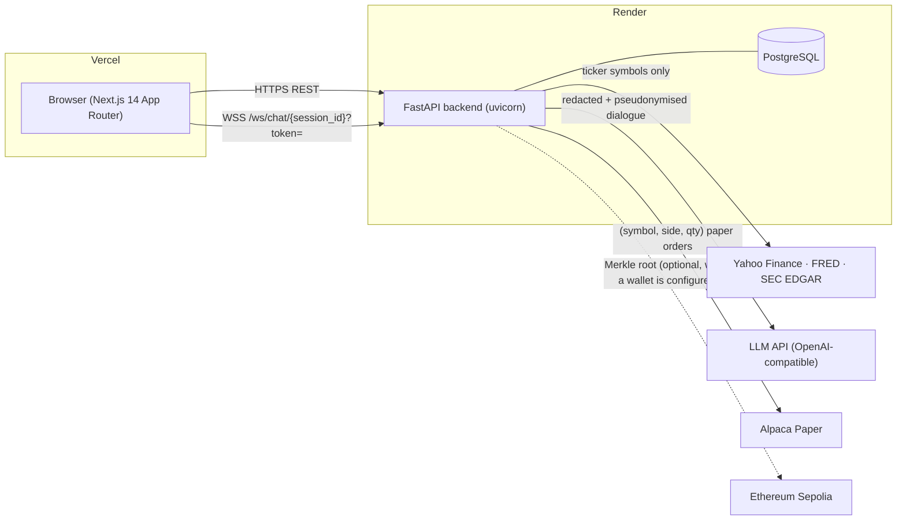
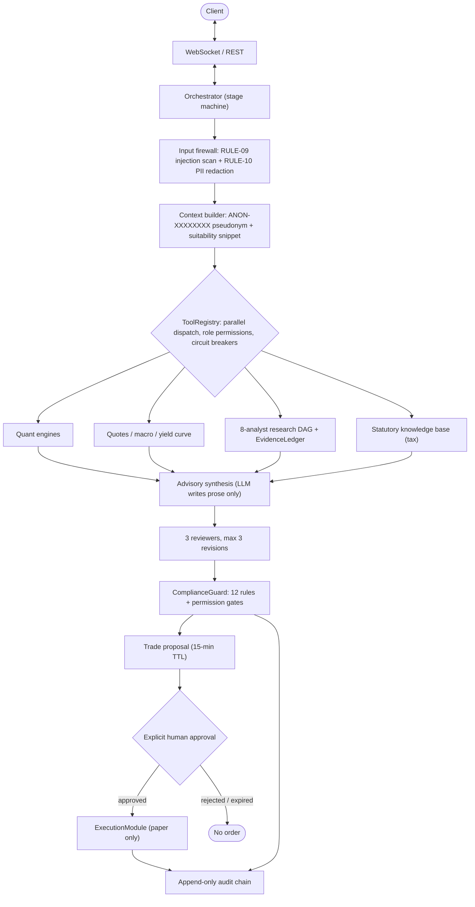

# FinFuture — Technical Documentation (Deliverable 01)

**Competition:** 2026 8th FinTechathon — International Track · **Topic B: Wealth Advisory Agent**
**System:** FinFuture — a non-discretionary, human-in-the-loop multi-agent wealth advisory platform
**Live demo:** Frontend <https://fin-future.vercel.app> · API <https://finfuture.onrender.com> (OpenAPI at `/docs`)
**Source:** <https://github.com/g93sambo/FinFuture>

> **Design principle:** *the model writes the words, deterministic code supplies the numbers, and no trade can execute without explicit human approval under code-enforced limits.*

---

## 1. Scope and how it maps to Topic B

Topic B asks for an agent that mirrors a professional wealth-advisory workflow — **product comparison, client risk profiling, and advisory dialogue** — producing **compliant and explainable asset-allocation suggestions**.

| Topic B requirement | Where it lives |
| :--- | :--- |
| Client risk profiling | `backend/agents/risk_profiler.py` — conversational onboarding, deterministic scoring |
| Product comparison | `backend/agents/product_comparison.py` — 6-factor scoring of ETFs and bonds |
| Advisory dialogue | `backend/agents/orchestrator.py` + `backend/api/routes/ws.py` / `chat.py` |
| Allocation suggestions | `backend/agents/allocation_engine.py`, `backend/services/black_litterman.py` |
| Compliant | `backend/agents/compliance_guard.py` (12 rules + 5 permission gates) |
| Explainable | per-rule results, evidence ledger with citations, audit trail with Merkle proofs |

---

## 2. System architecture

### 2.1 Deployment topology



| Layer | Technology | Notes |
| :--- | :--- | :--- |
| Frontend | Next.js 14 (App Router), React, TypeScript, Tailwind | Vercel; REST + WebSocket with automatic HTTP fallback |
| Backend | FastAPI, Pydantic v2, SQLAlchemy (async), asyncpg | Render |
| Storage | PostgreSQL (prod), SQLite (local dev); optional Redis cache | Redis degrades gracefully to an in-process cache |
| Auth | bcrypt password hashing, HS256 JWT bearer tokens | `backend/core/security.py` |

### 2.2 Request pipeline



### 2.3 Conversation stage machine

`PROFILING → ADVICE_GENERATION → PROPOSAL_REVIEW → (execution) → ADVICE_GENERATION`

- **PROFILING** — `RiskProfilerAgent` extracts age, income, net worth, horizon, goals and drawdown behaviour from dialogue. Extraction is hybrid: deterministic heuristics plus optional LLM assistance, and it still works with no LLM key configured.
- **ADVICE_GENERATION** — free-form advisory with tool calls (quotes, comparisons, allocation, tax, research).
- **PROPOSAL_REVIEW** — a staged `TradeProposal` awaits approve/reject.

### 2.4 Restart resilience

Proposals and locks live in Redis when it is available, otherwise in process memory. Two database fallbacks keep the trade path correct across a restart. Both query audit entries inside the proposal TTL window (15 min + 60 s skew margin). A regression test covers both.

- **Proposal recovery:** if a `proposal_id` is not in the cache, `handle_trade_approval` looks it up in recent `TRADE_PROPOSED` audit entries. It accepts the proposal only if it is still inside the 15-minute TTL.
- **Replay rejection:** an already-executed proposal is found in `TRADE_EXECUTED` audit entries and rejected with `DuplicateTradeError` (HTTP 409). Separately, `ExecutionModule` rejects an identical client, symbol and side committed in the last 30 s.

### 2.5 Backend module map

| Path | Responsibility |
| :--- | :--- |
| `backend/main.py` | App factory, CORS, router mounting, fixture warm-up, default rule seeding |
| `backend/api/routes/` | `auth`, `session`, `chat`, `profile`, `compare`, `portfolio`, `trade`, `audit`, `market`, `compliance`, `ws`, `asyncapi` |
| `backend/agents/` | `orchestrator`, `risk_profiler`, `product_comparison`, `allocation_engine`, `behavioral_bias`, `review_stage`, `compliance_guard`, `execution_module`, `market_data` |
| `backend/services/` | `financial_engineering`, `black_litterman`, `audit_logger`, `anchoring`, `sanitizer`, `evidence_ledger`, `context_builder`, `portfolio_service`, `data_pipeline`, providers (`equities`, `macro`, `treasury`, `sec_edgar`, `screener`, …) |
| `backend/tools/` | `ToolRegistry`, adapters (retry/backoff/circuit breaker), 22 registered tools |
| `backend/research/` | `task_graph` (DAG), `memory` (tenant-isolated), `verification` (self-check loop) |
| `backend/db/` | SQLAlchemy models, async engine, Alembic migrations |
| `frontend/src/app/app/*` | Advisor chat, allocation, compare, markets, trade, audit, compliance, health, profile |

### 2.6 Data model (`backend/db/models.py`)

| Table | Purpose |
| :--- | :--- |
| `users` | Credentials (bcrypt hash), active flag |
| `client_profiles` | Suitability profile, KYC/AML/PEP flags, psychology scores — owned by one user |
| `chat_sessions` / `chat_messages` | Persistent multi-turn history (text, attachments, structured events) |
| `portfolio_snapshots` | Point-in-time holdings for drift/health |
| `trades` | Paper-order records (status, fill, broker, approval timestamp, compliance report) |
| `audit_log` | Append-only hash-chained, HMAC-signed trail; UPDATE/DELETE rejected by ORM event hooks |
| `behavioral_memory` | Detected biases and interventions |
| `compliance_rules` | Rule catalogue, seeded from `DEFAULT_COMPLIANCE_RULES` |

---

## 3. Core algorithm description

All arithmetic is deterministic Python. The LLM is never asked to calculate a figure; it receives computed results and writes explanation around them.

### 3.1 Risk profiling (`risk_profiler.py`)

1. Fields are collected conversationally and validated per state (`validate_state_completion`).
2. `calculate_suitability_score` combines age, horizon, income stability, liquidity buffer and loss capacity into a risk score and category.
3. **Behavioural calibration:** the *stated* tolerance is compared with the *revealed* tolerance from drawdown-reaction questions; the profile uses the **more conservative** of the two (`min(stated, revealed)`).
4. `calculate_emotional_risk_score` and `calculate_panic_sell_likelihood` feed bias detection (`behavioral_bias.py`).
5. `evaluate_compliance_kyc_aml` sets the KYC/AML flags that later gate execution.

### 3.2 Product comparison (`product_comparison.py`)

Each product is scored 0–100 on six factors: **expense ratio, tracking error, liquidity, AUM, historical return, issuer reputation**. A weighted composite ranks candidates, then `evaluate_suitability` filters against the client's profile (risk ceiling, horizon, liquidity) so a high-scoring but unsuitable product is flagged rather than recommended.

### 3.3 Allocation (`allocation_engine.py`, `black_litterman.py`)

- **Black–Litterman** (`compute_black_litterman`) blends market-implied equilibrium returns with research views to produce posterior expected returns.
- **CVaR optimisation:** weights minimise 95 % Conditional Value-at-Risk subject to the client's risk ceiling and concentration limits.
- **Efficient frontier** (`generate_efficient_frontier`) and **attribution** (`calculate_analytical_attribution`) explain *why* the weights are what they are.
- **Rebalancing** (`generate_rebalancing_trades`) converts target-vs-current weights into draft orders — never executed directly.

### 3.4 Financial engineering (`financial_engineering.py`)

| Function | Method |
| :--- | :--- |
| `run_reproducible_monte_carlo` | 10,000-path multivariate **Student-t (ν = 5)** simulation with variance-normalised, Cholesky-correlated shocks and a fixed seed (`42`), so a result can be re-derived |
| `solve_required_return` | Bisection root-finder for the return needed to reach a target with periodic withdrawals |
| `generate_10year_cash_flow_table` | Deterministic year-by-year balance recursion |
| `run_explicit_stress_tests` | Named macro shocks (stagflation, GFC-style, rate shock) with recovery trajectories |
| `calculate_var_cvar_sharpe` | Parametric and historical VaR, CVaR, Sharpe |
| `calculate_dcf_valuation` | Unlevered-FCF DCF with WACC and terminal value |
| `calculate_hurdle_score` | Five-pillar 0–100 score with a binary decision rule |

### 3.5 Multi-reviewer verification (`review_stage.py`)

Before advice reaches the client, three independent reviewers run in parallel: **Suitability**, **Devil's Advocate**, and **Numeric Consistency**. Failures trigger a revision loop of at most three iterations; unresolved issues escalate to a human instead of shipping.

### 3.6 Research DAG (`backend/research/`)

A declarative task graph dispatches eight specialist roles (macro, financial, investment research, quantitative, intelligence, risk/devil's-advocate, personalised advisory, compliance) in parallel where dependencies allow. Every factual claim is recorded in an `EvidenceLedger` with source URL, publisher and timestamp; a bounded self-verification pass (≤ 2 iterations) re-checks citations and table figures before the report is emitted.

---

## 4. Security design

> The adversarial view of this design — including what is **not** protected — is in [`SECURITY_SELF_ASSESSMENT.md`](../SECURITY_SELF_ASSESSMENT.md).

### 4.1 Identity and tenancy
- bcrypt-hashed passwords (72-byte truncation handled explicitly); HS256 JWT with a configurable lifetime (default 60 min).
- Five failed logins for one account within 15 minutes return HTTP 429 with `Retry-After`. The counter is in-process.
- With `ENVIRONMENT=production` the app refuses to start if `SECRET_KEY` or `AUDIT_SECRET_KEY` is the development default, shorter than 32 characters, or identical to the other.
- CORS allows the configured `CORS_ORIGINS` plus `CORS_ORIGIN_REGEX`. The regex defaults to this project's Vercel domains and localhost.
- Every client-scoped route calls `verify_client_ownership`, so one user cannot read another's profile, portfolio, trades or audit log.
- WebSocket sessions are bound to the authenticated user; a connection to another tenant's session is closed with code **1008**.

### 4.2 Five-tier permission model

| Tier | Scope | State change |
| :--- | :--- | :--- |
| `TIER_1_READ_ONLY` | Market, macro, filings, portfolio reads | None |
| `TIER_2_ADVISE` | Profiling, comparison, simulation | None |
| `TIER_3_PROPOSE_TRADE` | Stage an unsigned proposal (15-min TTL) | Proposal record only |
| `TIER_4_EXECUTE_WITH_APPROVAL` | Paper order after explicit approval and compliance pass | Order + audit entry |
| `TIER_5_AUTONOMOUS_DISABLED` | Autonomous execution | **Forbidden** — startup refuses to boot if enabled |

### 4.3 Compliance firewall (`ComplianceGuard`, pure Python, outside the LLM)

- **12 rules:** `SUIT-001..003`, `CONC-001..003`, `REG-001..004`, `AML-001..002`.
- **Permission gates:** `PERM-TIER-5`, `PERM-CIRCUIT-BREAKER`, `PERM-WHITELIST`, `PERM-CAP-DAILY`, `PERM-STEP-UP-MFA`.
- **Limits:** per-trade \$100,000; rolling 24 h \$250,000; 101-symbol whitelist (`ALLOWED_TRADING_SYMBOLS`, symbols tradable on Alpaca); 15-minute approval freshness; 30-second double-submit lock (cache lock plus a durable PostgreSQL check on client + symbol + side).
- **Step-up one-time code:** orders over \$1,000 or 5 % of NAV need an emailed one-time code and an attestation, on every approval path. `POST /api/v1/trade/{proposal_id}/step-up` makes `StepUpOTPService` (`services/otp_service.py`) generate 6 random digits, store only an HMAC-SHA256 digest bound to the user and proposal, and email the code via Brevo, Resend or SMTP. Codes expire in 5 minutes, allow 5 attempts and are single-use, and resends are throttled. An approval without a code (chat "yes", WebSocket approve, bare REST call) is turned back with `StepUpRequiredError`; a wrong code returns `InvalidStepUpCodeError` with the attempts left. The compliance guard accepts the trade only when the orchestrator has verified the code server-side.
- **Circuit breaker:** ≥ 3 violations within 60 s locks execution for 15 minutes. The compliance console's drill button records `SIMULATED_DRILL` incidents. Only a lock caused entirely by drills can be reset by the user; otherwise the reset endpoint returns HTTP 423.

### 4.4 Prompt-injection and privacy controls
- **Inbound:** `RULE-09` scans user text for jailbreak and bypass patterns.
- **External content:** web and filing text is stripped of HTML/scripts and wrapped in `<untrusted_external_content>` before the model sees it (`sanitizer.py`).
- **Outbound to LLM:** `redact_sensitive_data` removes names, e-mails, phone numbers, national IDs, card numbers, IBANs and tokens; the client is referred to by a one-way `ANON-XXXXXXXX` pseudonym.
- **Market/macro/filing APIs** receive only tickers, CIKs or series IDs.

### 4.5 Tamper-evident audit trail
- `entry_hash = SHA-256(prev_hash ‖ client_id ‖ event_type ‖ canonical_details ‖ timestamp)`, starting from a 64-zero genesis hash.
- Each entry is signed with HMAC-SHA-256; the chain can be re-verified with `GET /api/v1/audit/{client_id}/verify` or `tools/verify_audit.py`.
- Entry hashes form a binary SHA-256 Merkle tree (odd nodes duplicated). Inclusion proofs are served at `/audit/{client_id}/merkle-proof/{entry_id}` and verified against the root server-side.
- **Anchoring:** with `SEPOLIA_RPC_URL` and a funded testnet `SEPOLIA_PRIVATE_KEY`, `POST /audit/{client_id}/anchor` sends a zero-value transaction whose input data is the 32-byte Merkle root, returns its Etherscan link and records an `AUDIT_ANCHORED` audit entry. Without a wallet nothing is sent and no hash is returned. Mainnet (chain ID 1) is hard-rejected. See the README section "Checking on-chain anchors".

### 4.6 Execution safety
Paper trading only: the Alpaca base URL is validated at startup and live endpoints are refused. `ALLOW_AUTONOMOUS_EXECUTION` must be `false` or the application will not start.

---

## 5. API surface

Full machine-readable specs: `GET /openapi.json` (REST) and the AsyncAPI document served by `asyncapi.py` (WebSocket).

| Group | Representative endpoints |
| :--- | :--- |
| System | `GET /health`, `/docs` |
| Auth | `POST /api/v1/auth/register`, `/login`, `GET /auth/me` |
| Session & chat | `POST /api/v1/session/start`, `GET/POST /api/v1/chat/sessions`, `GET/PATCH/DELETE /chat/sessions/{id}`, `POST /chat/message` |
| Profile | onboarding questionnaire, profile read/update |
| Markets & allocation | quotes, history, macro, `allocation/optimize`, `allocation/current`, product `compare` |
| Trade | propose, `trade/{proposal_id}/step-up` (email a one-time code), execute, `trade/orders` |
| Compliance & audit | `compliance/check`, `compliance/check-input`, `compliance/permission-tiers`, `audit/logs`, `audit/{client_id}/verify`, anchor, Merkle proof |
| Streaming | `WSS /ws/chat/{session_id}?token=…` |

---

## 6. Test strategy and results

| Layer | Location | What it proves |
| :--- | :--- | :--- |
| Unit | `backend/tests/unit/` | Compliance rules, execution gates, quant maths, audit chain, security, orchestrator |
| Adversarial | `backend/tests/unit/test_challenger_*`, `tests/adversarial/` | Injection, concurrency, boundary and tamper cases |
| Research E2E | `tests/e2e_research/` | Four-tier requirement-driven DAG tests |
| Live production | `evidence/live_e2e_results.json` | Zero-mock run against the deployed Render and Vercel apps, including the audit hash chain (`entry_hash` / `prev_hash`) and its verification |

Local run of the Python suite as CI runs it (2026-10-20; `backend/tests`, `tests/e2e_research`, `tests/unit`): **930 passed, 0 failed**. This includes `test_step_up_otp.py` (15 tests: randomness, digest-only storage, single use, user binding, attempt limit, resend throttling, expiry, fail-closed production delivery and the orchestrator gate).

Live production run (2026-10-18): **57 / 57 operations passed, 0 HTTP 500s**, covering auth, chat persistence in PostgreSQL, trade execution and 30 s duplicate lock, compliance, audit-chain verification, frontend assets and WebSocket handshake. Raw results, including the hash-chained audit entries: `evidence/live_e2e_results.json`.

Reproduce locally:

```bash
PYTHONPATH=backend:. python -m pytest backend/tests tests -q   # PowerShell: $env:PYTHONPATH="backend;."
(cd frontend && npx tsc --noEmit)
```

---

## 7. Deployment

| Component | Platform | Key settings |
| :--- | :--- | :--- |
| Backend | Render web service | `DATABASE_URL`, `SECRET_KEY`, `AUDIT_SECRET_KEY`, `CORS_ORIGINS`, `ALPACA_*`, `OPENAI_API_KEY`, `DRY_RUN`, email provider for step-up codes (`BREVO_API_KEY` + `EMAIL_FROM`; Render's free tier blocks SMTP) |
| Frontend | Vercel | `NEXT_PUBLIC_API_URL` = the Render service URL (the WebSocket URL is derived from it automatically) |

Environment variable names are defined in `backend/core/config.py` and listed in `.env.example`. With `ENVIRONMENT=production`, the backend **refuses to start** unless `SECRET_KEY` and `AUDIT_SECRET_KEY` are set to two different random values of at least 32 characters. Generate them with `python -c "import secrets; print(secrets.token_urlsafe(48))"`. `CORS_ORIGIN_REGEX` can override the default allowed Vercel domains.

Local run:

```bash
# backend
cd backend && python -m venv .venv && source .venv/bin/activate
pip install -r requirements.txt
uvicorn main:app --reload --port 8000

# frontend
cd frontend && npm install && npm run build && npm run start
```

Containerised: `docker compose up --build` starts PostgreSQL, Redis, the backend and the frontend (`docker-compose.yml`, `backend/Dockerfile`, `frontend/Dockerfile`).

---

## 8. Third-party components and licensing

Open-source dependencies are listed in `backend/requirements.txt` and `frontend/package.json`. Market data is read from public providers (Yahoo Finance, FRED, SEC EDGAR); the project is released under the MIT License (`LICENSE`).
